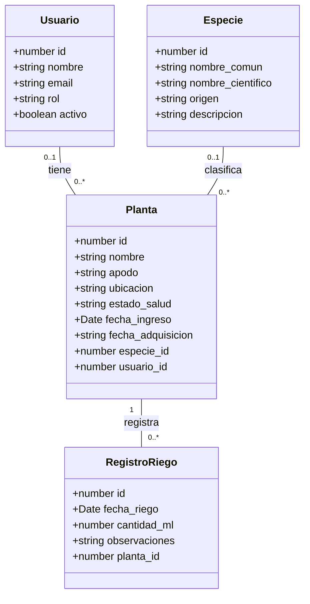
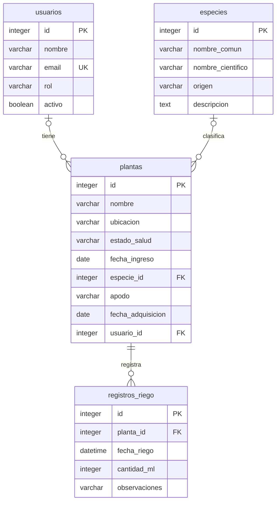

# Backend — Gestión de plantas y registros de riego

Proyecto del Grupo 03 para el curso Desarrollo de Backend (ICINF1108).

API REST desarrollada con NestJS y TypeScript para administrar usuarios, especies, plantas y registros de riego. Los datos se almacenan en SQLite mediante TypeORM.

## Tecnologías

- NestJS y TypeScript.
- TypeORM y SQLite.
- class-validator y class-transformer.
- Swagger / OpenAPI.
- Thunder Client para pruebas manuales.

## Organización del código

```text
src/
  controllers/       Rutas y recepción de solicitudes HTTP
  domain/entities/   Entidades y relaciones de TypeORM
  dto/               Validación de entradas y documentación de respuestas
  repositories/      Consultas de persistencia específicas
  services/          Reglas de negocio y operaciones sobre los datos
  migrations/        Migraciones del esquema de la base de datos
  app.module.ts      Registro de controladores, servicios y base de datos
  data-source.ts     Configuración de TypeORM para ejecutar migraciones
  http-error.filter.ts  Formato de errores HTTP
  main.ts            Inicio del servidor y configuración de Swagger
  seed.ts            Carga de datos de ejemplo
```

Una solicitud llega al controlador, sus datos se validan mediante DTOs y el servicio aplica las reglas de negocio. Los servicios utilizan repositorios de TypeORM para consultar y modificar SQLite. El filtro global convierte las excepciones en respuestas JSON estructuradas.

Las entidades contienen también los decoradores de persistencia de TypeORM.

## Entidades y relaciones

- **Usuario:** id, nombre, email, rol y activo.
- **Especie:** id, nombre común, nombre científico, origen y descripción.
- **Planta:** id, nombre, apodo, ubicación, estado de salud, fechas e identificadores de especie y usuario.
- **Registro de riego:** id, fecha de riego, cantidad en mililitros, observaciones e identificador de planta.

Relaciones:

- Un usuario puede tener varias plantas.
- Una especie puede estar asociada a varias plantas.
- Una planta puede tener varios registros de riego.

La base de datos define eliminación en cascada de plantas al eliminar su especie y de registros de riego al eliminar su planta. Al eliminar un usuario, sus plantas permanecen con `usuario_id` en `null`.

## Diagrama de clases



Una planta puede tener un usuario y una especie asociados. En el esquema actual, ambas relaciones permiten valores nulos. Cada registro de riego pertenece obligatoriamente a una planta.

## Diagrama de base de datos



`PK` identifica una clave primaria, `FK` una clave foránea y `UK` una restricción de unicidad.

Aunque la base de datos permite que `especie_id` y `usuario_id` sean nulos, el DTO de creación de plantas exige ambos identificadores.

## Requisitos

- Node.js y npm.
- Git.

## Instalación

```powershell
git clone https://github.com/CMardones06/backend-2026-grupo-03.git
cd backend-2026-grupo-03
git switch feature/dominio-y-persistencia
npm install
```

## Configuración y base de datos

La aplicación utiliza estas variables de entorno:

| Variable | Valor predeterminado | Propósito |
|---|---|---|
| `PORT` | `3000` | Puerto del servidor |
| `DB_DATABASE` | `database.sqlite` | Ruta del archivo SQLite |

Ejemplo en PowerShell para utilizar una base de verificación independiente:

```powershell
$env:PORT = '3001'
$env:DB_DATABASE = 'verificacion-seed.sqlite'
npm run build
npm run migration:run
npm run seed
npm run start:prod
```

Las variables deben definirse en la misma terminal donde se ejecutan los comandos.

Las migraciones crean el esquema de la base de datos. El seed elimina los datos existentes de las cuatro entidades y carga dos usuarios, dos especies, dos plantas y dos registros de riego. Ejecutarlo únicamente sobre una base destinada a datos de ejemplo.

Para iniciar en modo desarrollo:

```powershell
npm run start:dev
```

SQLite conserva los datos después de detener y reiniciar el servidor, siempre que se utilice el mismo archivo de base de datos.

## Endpoints

La API implementa 20 operaciones:

| Recurso | Crear | Listar | Consultar | Actualizar | Eliminar |
|---|---|---|---|---|---|
| Usuarios | `POST /usuarios` | `GET /usuarios` | `GET /usuarios/{id}` | `PUT /usuarios/{id}` | `DELETE /usuarios/{id}` |
| Especies | `POST /especies` | `GET /especies` | `GET /especies/{id}` | `PUT /especies/{id}` | `DELETE /especies/{id}` |
| Plantas | `POST /plantas` | `GET /plantas` | `GET /plantas/{id}` | `PUT /plantas/{id}` | `DELETE /plantas/{id}` |
| Riegos | `POST /riegos` | `GET /riegos` | `GET /riegos/{id}` | `PUT /riegos/{id}` | `DELETE /riegos/{id}` |

Las actualizaciones mediante PUT permiten enviar solamente los campos que se desean modificar.

### Paginación y filtros

Usuarios utiliza `pagina` y `limite`, permite filtrar por rol y ordenar los resultados:

```text
GET /usuarios?rol=user&ordenar_por=nombre&direccion=asc&pagina=1&limite=1
```

Su respuesta contiene `items`, `total`, `pagina`, `limite` y `total_paginas`.

Especies, plantas y riegos utilizan `page` y `limit`:

```text
GET /plantas?page=1&limit=10
```

Sus respuestas contienen `data`, `total`, `page` y `lastPage`.

La página mínima es 1 y el límite permitido es de 1 a 100.

## Validaciones y reglas de negocio

- El correo de un usuario debe tener un formato válido y ser único.
- El rol debe ser `admin` o `user`.
- Los identificadores deben ser enteros.
- Los DTOs validan campos obligatorios, tipos, longitudes, fechas y valores permitidos.
- Las relaciones referenciadas deben existir.
- La cantidad de riego debe ser un entero mayor que cero.
- La fecha de riego no puede ser posterior a la fecha y hora actual.
- No se pueden registrar nuevos riegos para una planta con estado `Muerta`.

## Respuestas y errores

- `200`: consulta, actualización o eliminación exitosa.
- `201`: creación exitosa.
- `400`: identificador con formato inválido o incumplimiento de determinadas reglas de negocio.
- `404`: recurso inexistente.
- `409`: conflicto por correo duplicado.
- `422`: datos rechazados por las validaciones de entrada.

Los errores utilizan esta estructura:

```json
{
  "error": {
    "code": "USUARIO_NO_ENCONTRADO",
    "message": "No existe un usuario con el id 999999",
    "details": []
  }
}
```

Las eliminaciones exitosas responden con estado 200 y un mensaje de confirmación.

## Documentación Swagger

Con el servidor iniciado:

- Puerto predeterminado: http://localhost:3000/api
- Configuración de verificación: http://localhost:3001/api

Swagger documenta las operaciones, parámetros, cuerpos de entrada, ejemplos y respuestas.

## Pruebas manuales

Las solicitudes están guardadas en:

- `test/pruebas-api.http`
- `test/pruebas-api.postman_collection.json`

La colección JSON fue exportada desde Thunder Client en formato Postman.

Los casos incluyen creación, consulta, actualización, eliminación, correo duplicado, correo inválido, recurso inexistente, identificador inválido, paginación y fecha futura de riego.

Para repetirlos:

1. Iniciar el servidor en el puerto 3001 con una base de ejemplo preparada.
2. Ejecutar las solicitudes en el orden indicado.
3. En Thunder Client, utilizar el ID devuelto por la creación en las consultas, actualizaciones y eliminación del usuario QA.
4. Si el correo de prueba ya existe por una ejecución incompleta, cambiarlo tanto en la solicitud de creación como en la prueba de duplicidad.
5. Ejecutar la eliminación al final y comprobar que la consulta posterior devuelve 404.

El archivo `.http` utiliza una referencia a la respuesta de creación para obtener el ID del usuario. Puede ejecutarse con la extensión REST Client de VS Code.

Las solicitudes POST y PUT que envían JSON utilizan `Content-Type: application/json`.

## Resultados de pruebas

Verificación realizada el 2 de noviembre de 2026 sobre
`http://localhost:3001`.

| Caso | Solicitud GET | Resultado esperado | Resultado obtenido |
|---|---|---|---|
| Usuario inexistente | `/usuarios/999999` | 404 y error de recurso inexistente | 404, código `USUARIO_NO_ENCONTRADO` |
| Identificador inválido | `/usuarios/abc` | 400 y rechazo del identificador | 400, mensaje `Validation failed (numeric string is expected)` |
| Página inválida | `/usuarios?pagina=0` | 422 y error de validación | 422, código `VALIDATION_ERROR`, detalle `pagina must not be less than 1` |
| Filtro, orden y paginación | `/usuarios?rol=user&ordenar_por=nombre&direccion=asc&pagina=1&limite=1` | 200, usuarios de rol user ordenados por nombre y máximo un resultado | 200, Juan Pérez, total 2, página 1, límite 1 y total de páginas 2 |

Los cuatro casos coincidieron con los resultados esperados.
Los resultados del listado dependen de los datos presentes en la base.

### Creación, actualización, reglas de negocio y eliminación

Pruebas realizadas con Thunder Client el 2 de noviembre de 2026.

| Caso | Solicitud y entrada | Resultado esperado | Resultado obtenido |
|---|---|---|---|
| Crear usuario | POST `/usuarios`, nombre `Usuario Evidencia`, email `evidencia.crud.02@example.com`, rol `user`, activo `true` | 201 y usuario con ID generado | 201 Created, usuario con ID 5 y los datos enviados |
| Rechazar correo duplicado | POST `/usuarios`, nombre `Usuario Duplicado`, mismo email, rol `user`, activo `true` | 409 y código `EMAIL_ALREADY_EXISTS` | 409 Conflict y código `EMAIL_ALREADY_EXISTS` |
| Actualizar usuario | PUT `/usuarios/5`, cuerpo `{"nombre":"Usuario Evidencia Actualizado"}` | 200, nombre actualizado y demás datos conservados | 200 OK, nombre actualizado; mismo ID, email, rol y activo |
| Rechazar riego futuro | POST `/riegos`, planta_id `1`, fecha_riego `2099-01-01T12:00:00Z`, cantidad_ml `100`, observaciones `Prueba de fecha futura` | 400 y código `INVALID_RIEGO_DATE` | 400 Bad Request y código `INVALID_RIEGO_DATE` |
| Eliminar usuario | DELETE `/usuarios/5`, sin cuerpo | 200 y mensaje de eliminación | 200 OK, mensaje de eliminación del usuario 5 |
| Confirmar eliminación | GET `/usuarios/5` | 404 y código `USUARIO_NO_ENCONTRADO` | 404 Not Found y código `USUARIO_NO_ENCONTRADO` |

Los seis casos coincidieron con los resultados esperados.
El ID 5 corresponde a esta ejecución; al repetir las pruebas debe
utilizarse el ID devuelto por la creación. La prueba de riego requiere
que exista la planta 1 y que su estado permita registrar riegos.

## Integrantes

- Josefa Ines Duarte Inostroza.
- Keisy Dayana Epul Landero.
- Maria Rayen Henriquez Cayuqueo.
- Camila Angelina Mardones Molina.